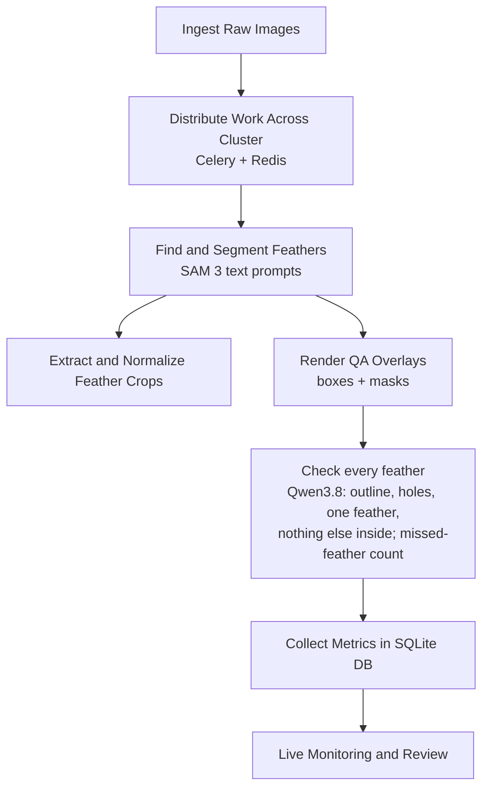

# Feather Molt Analysis Pipeline

A distributed feather segmentation pipeline for a scalable cluster of Celery workers using a Redis-backed task queue.

## Workflow Architecture


## Project Structure
- `data/raw/`: Input feather `.jpg` files.
- `data/processed/`: Output segmented feather crops.
- `src/full_run_distributed.py`: Dispatches all image tasks to the cluster.
- `src/celery_tasks.py`: Distributed task definitions.
- `src/feather_processing.py`: Core segmentation and extraction logic.
- `run_cluster.sh`: Bootstraps Redis, Celery workers, Flower, and starts the pipeline.

## Setup
Every node (head, workers) and every machine you drive runs from uses the same
[pixi](https://pixi.sh) environment (macOS on Apple silicon or Linux; MLX is only
installed on Apple silicon, where the VLM runs):

```bash
pixi install
pixi run setup        # R packages not on conda-forge (pavo, lightr)
cp .env.example .env  # head/worker hosts, SSH user/key, broker URL, VLM settings
```

SAM 3 weights are gated: request access at https://huggingface.co/facebook/sam3 and put
`sam3.pt` in the repo root on each worker. Without it the workers fall back to
`dino_sam2`.

## Node roles
| Role | Command | Notes |
|---|---|---|
| Broker (head) | `pixi run redis` | password taken from `BROKER_URL` |
| Worker (each node) | `pixi run worker` | `WORKER_CONCURRENCY`, default 1 |
| Dashboard (head) | `pixi run flower` | `http://<head>:5555` |
| VLM server (Apple silicon) | `pixi run vlm-server` | OpenAI-compatible, `:8790`, model `FEATHER_VLM_MODEL` |
| JupyterLab | `pixi run jupyter` | `:8889` |

## Cluster Run
1. Fill in `.env` (hosts, SSH, broker).
2. Place all feather images in `data/raw/` on the head.
3. Deploy and launch: the repo and environment are installed on every node, images are
   synced to the workers, then the broker, workers, dashboard and pipeline start.
   ```bash
   ./run_cluster.sh            # Celery: tasks are spread over all workers
   ./run_cluster_sharded.sh    # or: one fixed shard of data/raw per node
   ```
   If your workers are kept running by a service manager, set `FEATHER_MANAGE_WORKERS=0`.

## Monitoring
- Flower dashboard: `http://<head>:5555`
- Pipeline log on the head: `distributed_pipeline.log`
- Worker logs on each node: `celery_worker.log`
- `./monitor_cluster.sh`: memory pressure per node
- `pixi run check`: broker, workers and SSH reachability from this machine

## Driving runs from a notebook
Any machine with the environment and `.env` can submit work and inspect results while the
data and models stay on the cluster:

```bash
python -m src.submit_remote_pipeline \
  --remote-input-dir ~/bird-feather-analysis/data/raw \
  --remote-output-dir ~/bird-feather-analysis/data/processed
```

Label table, feather IDs, output file names, duplicate feathers and sample runs: [docs/label-table-and-sample-runs.md](docs/label-table-and-sample-runs.md).

### Archiving runs
`pixi run sync-runs` asks the head node to archive finished runs (`pixi run sync-status`
shows the last result). Test runs (`max_images` other than `all`, or ids containing
test/smoke/debug/tmp) are skipped.
